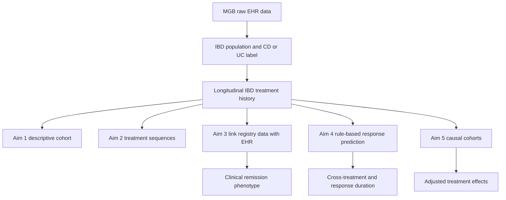
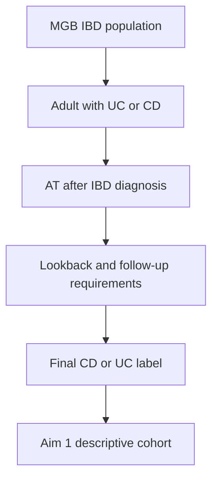
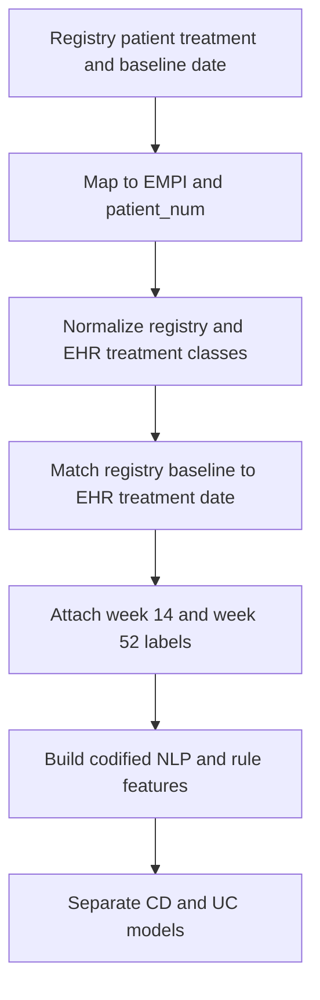
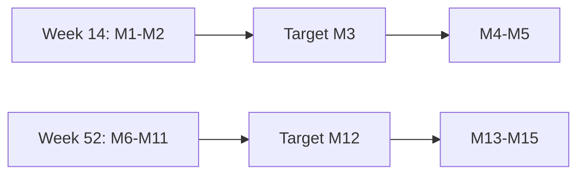
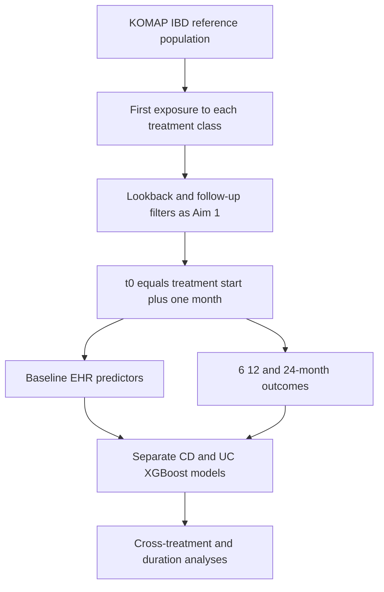
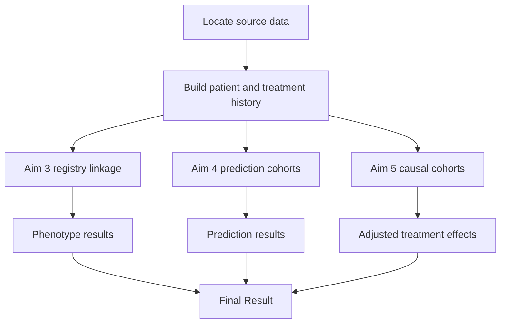

# MAJOR IBD Project README

**Owner:** Enci Cai

## Purpose

This README gives a concise overview of the MAJOR IBD project, including the shared data sources, cohort construction, study-derived datasets, and analyses for Aims 1-5. It is intended to help future analysts understand how the raw EHR data move into the aim-specific cohorts and results.

## Study aims and implemented workstreams

| Aim | Objective | Workstream |
| --- | --- | --- |
| Aim 1 | Describe baseline demographic and clinical characteristics of patients with UC and CD | Construct and describe the MGB IBD and advanced-therapy cohorts |
| Aim 2 | Identify advanced-therapy sequences, combination therapy, and time to switch | Convert medication histories into 3-month treatment states and identify common sequence patterns |
| Aim 3 | Develop and validate treatment-response phenotypes | Link clinician registry outcomes with EHR data and model 14-week and 52-week remission or response |
| Aim 4 | Predict short- and long-term treatment response | Predict rule-based response at 6, 12, and 24 months; test cross-treatment transportability and duration of response |
| Aim 5 | Compare treatment effectiveness after adjustment for baseline differences | Compare vedolizumab with anti-TNF and anti-IL-12/23 in first-line and TNF-switch cohorts using causal methods |

## Project-wide data flow

## Data Security and Restriction

- Keep all patient-level data in approved MGB secure computing environments.
- Treat `EMPI` and `patient_num` as research identifiers. Do not include `EMPI` in public outputs.
- Do not copy raw EHR data, registry data, clinical-note NLP data, or linkage files into public repositories.

## Data locations

MGB Windows server: `//SMBgpa.partners.org/asw_mgb$/`

MGB ERIS: `/data/aws-eris/`

### Raw data

**IBD_2020 database**

- Partners MSSQL server: `MGBSQL0055.partners.org`; database: `IBD_2020`.
- Batched codified `observation_fact` data: `//SMBgpa.partners.org/asw_mgb$/Sara/IBD/IBD_2020_codified/raw/`.
- Batched `visit_dimension` data: `//SMBgpa.partners.org/asw_mgb$/Sara/IBD/IBD_2020_codified/visit_dimension_table/raw/`.
- Full `concept_dimension` table, including `concept_path`, `concept_cd`, and `name_char`: `//SMBgpa.partners.org/asw_mgb$/Sara/IBD/For_Enci_2026-10-05/2026-10-05_concept_dimension_full_table.csv`.

**RPDR sources**

- SFA: `//SMBgpa.partners.org/asw_mgb$/SHARE/IBD_2019_MART_EXTENDED/`.
- SFA: `//SMBgpa.partners.org/asw_mgb$/SHARE/IBD_2019_2025_MART/`.
- ERIS: `/data/aws-eris/IBD_2019_MART_EXTENDED/`.
- ERIS: `/data/aws-eris/IBD_2019_2025_MART/`.

### Processed monthly data

- Codified monthly counts: `/data/aws-eris/IBD_DATA_REAGGREGATED/codified_data_monthly.RData`.
- NLP monthly counts: `/data/aws-eris/IBD_DATA_REAGGREGATED/NLP_data_monthly.RData`.

### Useful processed files

| Data | File path | Key columns | Used by |
| --- | --- | --- | --- |
| Comprehensive merged codified EHR | `//SMBgpa.partners.org/asw_mgb$/Xin/IBD/data_IBD_after_merge_05272025.RData` | `EMPI`, `Group_Code`, `date` | Aims 1, 2, 3, 4, 5 |
| AT patient index table | `//SMBgpa.partners.org/asw_mgb$/Xin/IBD/data/more_sensitivity/AT_ibd_drug_t0.RDS` | `EMPI`, first or index AT date, treatment group | Aims 1, 2, 4, 5 |
| All AT records | `//SMBgpa.partners.org/asw_mgb$/Xin/IBD/data/more_sensitivity/AT_ibd_drug_df.RDS` | `EMPI`, AT code or group, treatment date | Aims 1, 2, 4, 5 |
| All IBD-drug patient index table | `//SMBgpa.partners.org/asw_mgb$/Xin/IBD/data/more_sensitivity/all_ibd_drug_t0.RDS` | `EMPI`, first or index IBD-drug date, treatment group | Aims 1, 2, 5 |
| All IBD-drug records | `//SMBgpa.partners.org/asw_mgb$/Xin/IBD/data/more_sensitivity/all_ibd_drug_df.RDS` | `EMPI`, drug code or group, treatment date | Aims 1, 2, 5 |
| EMPI-to-patient mapping | `//SMBgpa.partners.org/asw_mgb$/SHARE/NLP/EMPI_to_Patient_num_full_mapping.csv` | `EMPI`, `Patient_num` | All linked analyses |
| Demographics | `//SMBgpa.partners.org/asw_mgb$/Xin/IBD/data/more_sensitivity/demo_data_all.RDS` | `EMPI`, date of birth, sex, race | Aims 1, 2, 4, 5 |
| KOMAP IBD reference population | `//SMBgpa.partners.org/asw_mgb$/Enci/causal_data/7_14/KOMAP_patientnum_disease.csv` | `patient_num`, `disease_pred_final` | Aims 1, 2, 4, 5 |
| Original laboratory pulls | `//SMBgpa.partners.org/asw_mgb$/SHARE/IBD_lab_data_yunqing/datapull_1/final_data.csv`; `datapull_2/final_data.csv`; `datapull_3/final_data.csv` | `EMPI` or `PATIENT_NUM`, lab name, raw/converted value, unit, date | Aims 4, 5 |
| Monthly laboratory summary | `//SMBgpa.partners.org/asw_mgb$/SHARE/IBD_lab_data_yunqing/monthly_summary/IBD_lab_monthly_summary.rds` and `.csv`; see `IBD_LAB_MONTHLY_README.md` in the same folder | `EMPI`, `PATIENT_NUM`, `LAB_NAME`, `UNITS`, `MONTH_START`, `N_MEASUREMENTS`, `MEAN`, `MIN`, `MAX`, `MEDIAN` | Aims 4, 5 |
| Cohort construction and flow counts | `//SMBgpa.partners.org/asw_mgb$/Xin/IBD/prep_data/more_sensitivity/` | Inclusion flags, exclusion steps, cohort counts | Aim 1|

The `*_t0.RDS` files contain the patient-level index record. The corresponding `*_df.RDS` files contain the longitudinal drug records. The `AT_*` pair is limited to advanced therapies; the `all_ibd_drug_*` pair also includes conventional IBD medications.

## Common time definitions

### Index date and t0

- The index date is the treatment initiation date. For a switching analysis, the index date is the switch date.
- In Aims 4 and 5, `t0 = index date + 1 month`.
- The one-month offset is a short run-in period that allows treatment initiation to be established and reduces misclassification from induction-period orders, delayed coding, and activity in the index month.
- Baseline predictors must occur on or before t0. Outcomes are evaluated after t0.

### Baseline and outcome windows by aim

| Aim | Feature window | Outcome window |
| --- | --- | --- |
| Aim 1 | Before and around the first qualifying AT date | Not Applicable |
| Aim 2 | Consecutive 3-month treatment windows | Treatment-state transitions over follow-up |
| Aim 3 | Around the registry assessment: Month 1-Month 5 for week 14 and Month 6-Month 15 for week 52 | Clinician or registry label at week 14 or week 52 |
| Aim 4 | Codified and NLP history from first UC/CD record through t0; labs from index minus 90 days through t0 | Rule-based response at 6, 12, and 24 months; quarter-based duration through 12 months |
| Aim 5 | Main confounder window from t0 minus 3 months through t0 | Binary response through 12 months and response duration through 24 months |

## Study-derived dataset 

| Aim | Features | Outcomes | Processing scripts folder |
| --- | --- | --- | --- |
| Aim 1 | Demographics, disease history, prior treatment, healthcare utilization, labs | Descriptive cohort summaries | `//SMBgpa.partners.org/asw_mgb$/Xin/IBD/prep_data/Aim1_summ/` |
| Aim 2 | Three-month treatment states and patient covariates | Sequence clusters, transition patterns, time to switch | `//SMBgpa.partners.org/asw_mgb$/Xin/IBD/medseq/`  |
| Aim 3 | Disease-specific codified top-50/top-100 features, NLP concepts, and month-specific rule components | Registry remission and remission-or-partial-response at week 14 and week 52 | `//SMBgpa.partners.org/asw_mgb$/Enci/Aim 3 phenotyping/` |
| Aim 4 | Demographics, prior AT, baseline steroid and hospitalization flags, codified and NLP counts, five lab domains | Five-rule response at 6, 12, and 24 months; steroid sensitivities; quarter-based duration | `//SMBgpa.partners.org/asw_mgb$/Enci/Aim 4 Treatment Response/` |
| Aim 5 | Demographics, disease duration, healthcare utilization, labs, and 10-dimensional EHR embedding | Four-rule 12-month response and 24-month response duration | `//SMBgpa.partners.org/asw_mgb$/Enci/causal_data/` |

# Aim 1 Baseline Cohort Description

## Objective

Describe the demographic and clinical characteristics of adults with UC or CD who receive an advanced therapy.

## Cohort

- Adult at treatment initiation.
- At least one qualifying UC or CD diagnosis.
- At least one AT exposure after the IBD diagnosis.
- UC and CD analyzed separately.

## Steps

1. Link the IBD population to demographics and treatment records.
2. Identify the first qualifying IBD diagnosis and AT index.
3. Apply age, calendar, lookback, and follow-up requirements.
4. Derive disease duration, prior therapy, steroid exposure, IBD hospitalization or ED use, surgery, healthcare utilization, and laboratory availability.
5. Produce the cohort flow and descriptive summaries separately for CD and UC.

# Aim 2 Advanced-Therapy Treatment Sequences - additional details to be filled by Xin

## Objective

Describe common AT sequences, combination therapy, and time to treatment switch.

## Method

1. Begin at the first prescription date and divide follow-up into consecutive 3-month windows.
2. Merge repeated records for the same medication within each window.
3. If more than one medication appears, use the most frequent treatment state; if a window is empty, carry forward the previous state.
4. Fit a mixture Markov model with `seqHMM`.
5. Select the number of clusters using the Bayesian information criterion.
6. Assign each patient to the cluster with the highest posterior probability and compare clinical characteristics across clusters.

The final medication-state dictionary, cluster count, and output filenames should be added by Xin.

# Aim 3 Linking Registry Data With EHR

## Objective

Develop EHR-based phenotyping models for clinician-assessed remission or response. 

## Registry population and known fields

The first registry cohort contained 461 eligible records, including approximately 228 CD, 214 UC records among patients with a baseline date. Known fields include the patient identifier, `drugsubstudy`, `baseline_date`, week-14, week-30, and week-52 outcomes, and endoscopic measures where available.

A second analysis used 338 patients with week-14 and week-52 remission labels. The usable outcome counts varied because labels were missing for some patients. We later decided to use this set of patients.

Registry filename and approved location: 

The first registry cohort: `//SMBgpa.partners.org/asw_mgb$/Enci/Aim 3 phenotyping/traetment response_for informatics_nodupl_mergedpatient_num_forXin_Feb6.xlsx`

The second registry cohort: `//SMBgpa.partners.org/asw_mgb$/Enci/MGH_data-LLM_project__EMPI_and_patientnum (2).xlsx`.

## Registry-to-EHR alignment

Normalize treatments as follows: ADA and IFX to anti-TNF; VEDO to anti-integrin; UPA and TOFA to JAK inhibitor; UST/USK and RIS to anti-IL-12/23.

### Historical alignment checks

- First AT-class agreement: 185 of 461 agreed, 270 disagreed, and 6 were missing.
- Same-drug earliest EHR event within plus or minus 30, 60, and 90 days: 301, 398, and 417 records.
- A later check found 388 records with any same-drug occurrence within plus or minus 30 days. Of these, 301 also had their earliest same-drug record in that window; the other 87 had evidence of earlier use.

### Recommended current alignment

1. Use the registry `baseline_date` as the clinician-defined treatment index.
2. Map registry identifiers to both `EMPI` and `patient_num` using a deduplicated mapping.
3. Require the same normalized treatment class in the EHR within the approved time span.
4. Use any same-drug occurrence within plus or minus 30 days as the broader linked cohort and earliest same-drug occurrence within plus or minus 30 days as the stricter sensitivity cohort.
5. Save unmatched, multiply mapped, prior-use, and conflicting-treatment records for review.

## Composite outcome

Two binary outcomes were evaluated at each assessment:

- Remission versus no response.
- Remission or partial response versus no response.

Summary of the second registry cohort:
| Outcome | Positive | Negative |
| --- | ---: | ---: |
| 3-month remission vs no response | 69 | 97 |
| 3-month remission or partial response vs no response | 204 | 97 |
| 12-month remission vs no response | 107 | 75 |
| 12-month remission or partial response vs no response | 187 | 75 |
## Feature windows and construction

- Codified EHR: ONCE-selected top 50 or top 100 concepts.
- NLP: top 200 clinical-note concepts.
- Keep concepts present in at least five patients and transform counts using `log(count + 1)`.
- At the target month, construct five rule indicators: remain on treatment; no corticosteroid; no immunomodulator; no IBD-related hospitalization or ED visit; and no IBD-related surgery.
- Fit CD and UC models separately.

## Modeling and results

Candidate models included penalized logistic regression, random forest, and XGBoost with repeated patient-level resampling. Evaluation focused on AUC, with calibration and threshold-based measures added where sample size allowed.

Best observed AUCs were:

| Assessment | Remission | Remission or partial response |
| --- | ---: | ---: |
| 3 months | 0.572 | 0.577 |
| 12 months | 0.758 | 0.663 |

The 12-month remission phenotype performed best. The early outcome models were close to chance, so these analyses should be treated as exploratory and dependent on the final registry linkage and label definitions.

# Aim 4 Rule-Based Treatment-Response Prediction

## Objective

Predict EHR-derived treatment response at 6, 12, and 24 months for vedolizumab, anti-TNF initiated in 2014 or later, and anti-IL-12/23. Evaluate treatment-specific performance, cross-treatment transportability, and duration of response.

## Cohort sequence and design

Patients can enter more than one treatment cohort if they received multiple therapy classes. These are overlapping prediction cohorts, not mutually exclusive causal treatment arms.

Final cohort characteristics:

|  | Vedolizumab | Anti-TNF (2014+) | Anti-IL-12/23 |
| --- | ---: | ---: | ---: |
| **N** | 2,705 | 5,441 | 2,709 |
| **Age at index, median [Q1, Q3]** | 43.9 [30.1, 61.1] | 32.6 [23.0, 50.6] | 40.0 [28.6, 55.5] |
| **Male** | 1,233 (45.6%) | 2,776 (51.0%) | 1,229 (45.4%) |
| **Female** | 1,472 (54.4%) | 2,665 (49.0%) | 1,480 (54.6%) |
| **White** | 2,406 (88.9%) | 4,709 (86.5%) | 2,398 (88.5%) |
| **Black** | 70 (2.6%) | 208 (3.8%) | 82 (3.0%) |
| **Asian** | 89 (3.3%) | 173 (3.2%) | 65 (2.4%) |
| **Other or unknown race** | 140 (5.2%) | 351 (6.5%) | 164 (6.1%) |
| **Prior AT before index** | 1,365 (50.5%) | 0 (0.0%) | 1,828 (67.5%) |
| **Baseline steroid use** | 1,373 (50.8%) | 2,405 (44.2%) | 1,178 (43.5%) |
| **Baseline IBD hospitalization** | 413 (15.3%) | 1,260 (23.2%) | 403 (14.9%) |

## Treatment-response outcome

A responder must meet all five criteria throughout the follow-up window:

- Remain on the index treatment at the standard or an escalated dose.
- Have no additional systemic corticosteroid prescription.
- Start no new immunomodulator.
- Have no IBD-related hospitalization or ED visit.
- Have no IBD-related surgery.

Failure of any component produces non-response. Outcomes were calculated at 6, 12, and 24 months.

Sensitivity outcomes were: ignore corticosteroid use during the first 3 months; remove the corticosteroid criterion; and divide the first 12 months into four quarters to measure duration of response. A quarter counted as responding only when all three monthly indicators met the selected definition; responding quarters did not need to be consecutive.

## Predictors and analysis

- Codified and NLP concept counts from the first UC/CD record through t0, transformed using `log(count + 1)` and adjusted for baseline healthcare utilization.
- Demographics, prior AT exposure, baseline steroid use, baseline IBD hospitalization, comorbidities, and medication or procedure history.
- CRP, albumin, ESR, fecal calprotectin, and hemoglobin from 90 days before treatment initiation through t0; last, mean, and maximum values were derived and missing values were imputed with `missRanger`.
- Separate XGBoost models by disease, treatment cohort, horizon, and outcome definition.
- Binary outcomes evaluated using AUC, PPV, and sensitivity; duration evaluated using the C-index.
- Cross-treatment testing applied each treatment-trained model to the other treatment cohorts with patient-level fold separation.

## Main findings

- At 12 months, AUCs were 0.741, 0.740, and 0.711 in CD and 0.728, 0.704, and 0.701 in UC for vedolizumab, anti-TNF, and anti-IL-12/23, respectively.
- At 80% specificity, 12-month PPV ranged from 65.1% to 76.8% in CD and from 65.3% to 69.6% in UC.
- Unmatched cross-treatment AUCs ranged from 0.691 to 0.729 in CD and from 0.697 to 0.728 in UC. Treatment-matched training was usually strongest, although some signal transferred across treatment classes.
- Baseline corticosteroid use was the most important feature in all six 12-month models. Other recurring domains included medication history, inflammatory and nutritional labs, age, disease duration, and codified or NLP-derived concepts.
- Original-definition duration C-indices ranged from 0.692 to 0.712 in CD and from 0.641 to 0.701 in UC. 

# Aim 5 Causal Comparative-Effectiveness Analysis

## Objective

Estimate adjusted differences in treatment response between vedolizumab and alternative advanced therapies in two treatment lines: first advanced therapy after conventional treatment and second-line therapy after an initial anti-TNF.

## Cohorts and outcomes

| Cohort | CD treatment counts | UC treatment counts |
| --- | --- | --- |
| First-line after aminosalicylate or immunomodulator | Vedo 195; anti-TNF 975; anti-IL-12/23 153 | Vedo 399; anti-TNF 777; anti-IL-12/23 58 |
| Second-line after a first anti-TNF | Vedo 218; another anti-TNF 471; anti-IL-12/23 517 | Vedo 321; another anti-TNF 267; anti-IL-12/23 95 |

JAK users were retained in descriptive cohort summaries but excluded from causal estimates because of small sample sizes and limited overlap.

The main causal outcome used four rules: remain on the index therapy, no IBD-related hospitalization or ED visit, no IBD-related surgery, and no systemic corticosteroid after the first 3 evaluated months. New immunomodulator use was not counted as failure so that the same definition could be applied to both treatment lines.

- Binary outcome: response through 12 months.
- Duration outcome: proportion of eight responding 3-month quarters through 24 months.

## Analysis

- `t0` was 1 month after the first AT start or switch date.
- Baseline confounders were measured from t0 minus 3 months through t0.
- Twenty-two confounders included demographics, disease duration, healthcare utilization, five lab domains, and a 10-dimensional EHR patient embedding derived from codified and NLP concepts.
- Cross-fitted augmented inverse probability weighting estimated the mean difference for vedolizumab minus the comparator. Positive values favor vedolizumab.
- Propensity overlap and standardized mean differences were checked for every disease, treatment line, and comparator.

## Latest results

Vedolizumab versus all anti-TNF:

| Treatment line and disease | 12-month response difference | 24-month duration difference |
| --- | ---: | ---: |
| First-line CD | +3.7 pp (95% CI -7.4 to 14.8; P=.512) | +5.3 pp (-1.1 to 11.8; P=.102) |
| First-line UC | **+9.8 pp (1.7 to 18.0; P=.018)** | **+7.0 pp (0.7 to 13.2; P=.030)** |
| TNF-switch CD | +0.0 pp (-9.4 to 9.4; P=.999) | +2.0 pp (-4.9 to 8.9; P=.567) |
| TNF-switch UC | +1.8 pp (-6.8 to 10.3; P=.686) | +4.4 pp (-2.3 to 11.2; P=.197) |

The adjusted first-line UC comparison favored vedolizumab. The CD and TNF-switch comparisons did not show statistically significant differences.

Vedolizumab versus anti-IL-12/23 produced no statistically significant difference in the first-line CD or UC comparisons. In the TNF-switch cohort, CD duration favored anti-IL-12/23 by 7.2 percentage points (P=.038), but this was an exploratory signal among multiple comparisons. The first-line UC comparison had residual imbalance and only 58 anti-IL-12/23 patients, so it should be interpreted cautiously.

### Infliximab-only sensitivity analysis

| Treatment line and disease | N, Vedo / infliximab | 12-month response difference | 12-month duration difference |
| --- | ---: | ---: | ---: |
| First-line CD | 195 / 392 | -5.6 pp (-19.0 to 7.8; P=.416) | -0.8 pp (-8.7 to 7.0; P=.833) |
| First-line UC | 399 / 382 | **+11.0 pp (1.3 to 20.6; P=.026)** | **+7.2 pp (0.3 to 14.2; P=.041)** |
| TNF-switch CD | 125 / 218 | -5.4 pp (-22.1 to 11.2; P=.524) | -2.5 pp (-14.7 to 9.8; P=.693) |
| TNF-switch UC | 140 / 126 | +4.9 pp (-8.0 to 17.9; P=.455) | +4.8 pp (-5.4 to 15.0; P=.359) |

For the TNF-switch infliximab analysis, patients whose first anti-TNF was infliximab were excluded from both arms because infliximab-to-infliximab is not a switch. The sensitivity analysis supports the first-line UC finding; the other comparisons remained compatible with no difference.

# End-to-End Execution Steps

1. Locate the source data, identifier maps, and treatment dictionaries.
2. Build a patient list containing `EMPI`, `patient_num`, CD/UC label, demographics, and first IBD date.
3. Build the complete longitudinal IBD-drug and AT histories.
4. Create or refresh the monthly codified, NLP, encounter, and laboratory layers.
5. Build the Aim 1 descriptive cohort and Aim 2 treatment-state sequences.
6. Link registry outcomes and build Aim 3 features separately for CD and UC.
7. Build Aim 4 treatment cohorts, baseline features, response outcomes, and prediction models.
8. Build Aim 5 treatment-line cohorts, confounders, outcomes, balance diagnostics, and causal estimates.

# Quality-Control Requirements

## Cohorts

- Count patients and treatment episodes before and after every filter.
- Check duplicate identifiers, one-to-many mappings, CD/UC distributions, index dates, age, calendar year, lookback, and follow-up.
- Save excluded patients with clear exclusion flags.

## Features

- Confirm that every feature date falls inside the declared window.
- Distinguish true zero counts from missing source coverage.
- Report codified and NLP coverage and the number of concepts before and after filtering.
- Check whether a source is already log-transformed before applying `log(count + 1)`.

## Outcomes

- Preserve source event dates and verify they occur after t0 and inside the outcome window.
- Report each rule separately and the final composite prevalence.
- Keep five-rule prediction outcomes separate from four-rule causal outcomes.
- Validate samples of positive and negative events against the source records.

# Glossary

| Term | Meaning |
| --- | --- |
| AT | Advanced therapy |
| CD | Crohn's disease |
| UC | Ulcerative colitis |
| EHR | Electronic health record |
| NLP | Natural language processing |
| CUI | Concept unique identifier |
| KOMAP IBD reference population | Project reference list used for IBD eligibility and final CD/UC classification |
| t0 | Analytic baseline, generally 1 month after treatment initiation or switch |
| HU | Healthcare utilization |
| AUC | Area under the receiver-operating-characteristic curve |
| PPV | Positive predictive value |
| AIPW | Augmented inverse probability weighting |
| SMD | Standardized mean difference |
| CRP | C-reactive protein |
| ESR | Erythrocyte sedimentation rate |
| FCP | Fecal calprotectin |
